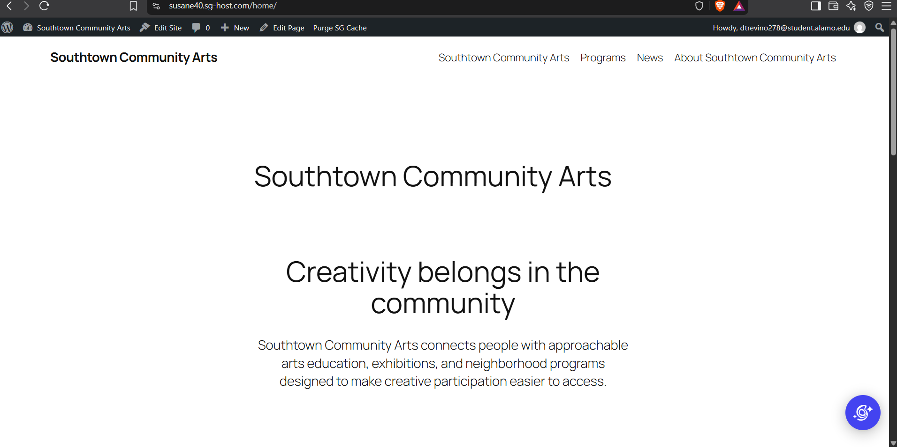
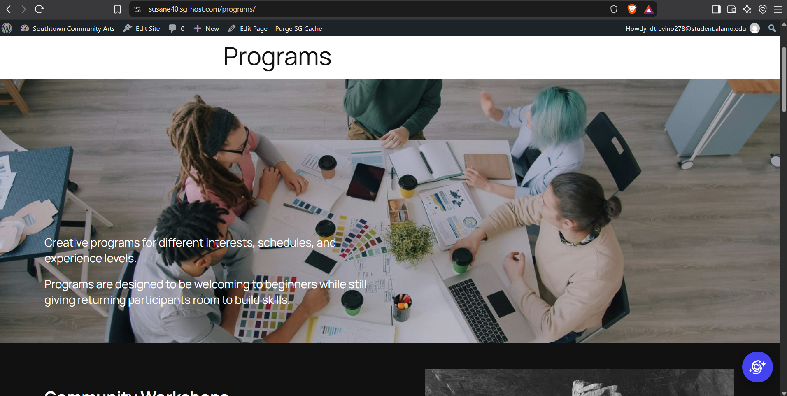
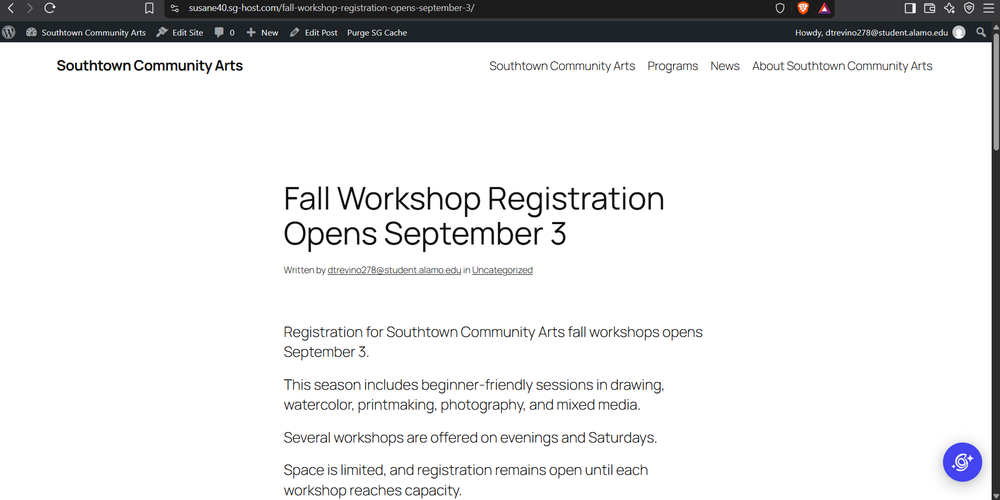
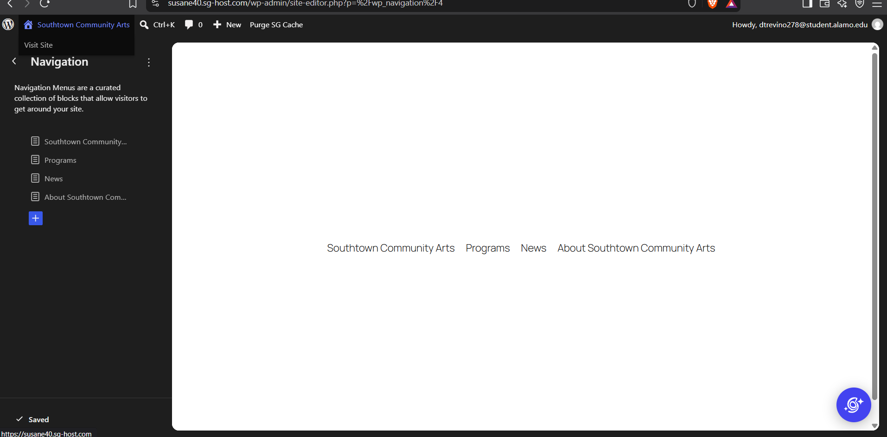
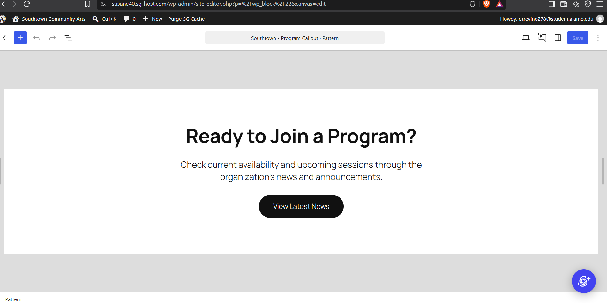
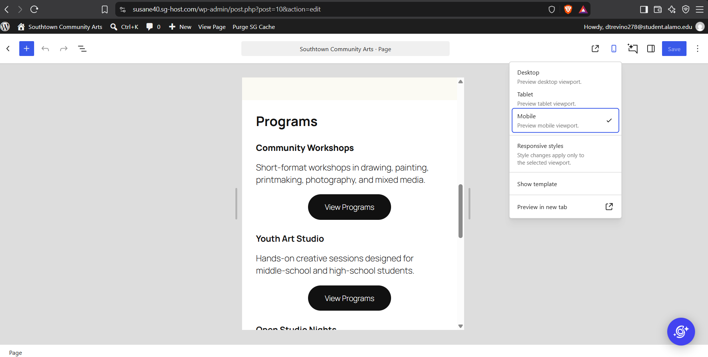

# Week 11: Build for Content — WordPress & CMS Fundamentals

## CMS Project Overview

**Client:** Southtown Community Arts  
**Role:** Junior Web / CMS Specialist  
**Week:** 11 — Build for Content: WordPress & CMS Fundamentals

Briefly summarize what you configured in WordPress.

[I configured a home, about, programs, and post pages with client provided content. The pages structure is assembled using wordpress pre designed layouts.]

---

## WordPress Site Access

**Site URL or instructor-access information:**  
[https://susane40.sg-host.com/]

---

# Content Architecture

I organized the supplied client content by using pre designed wordpress templates that would match the provided client content properly.

## Pages

List the Pages you created and briefly explain why they belong as Pages.

- **Home:** [The Southtown Community Arts page belongs as a brief opener to Southtown Community Arts, and the programs it has to offer]

- **Programs:** [The Programs page is a more in depth page for users to learn about the programs available and what they are about]

- **About:** [The About Southtown Community Arts page belongs as a brief statement and values section to strengthen the connection to users and guide them to the programs page]

## Post

**News Post:** [Fall Workshop Registration Opens September 3]

Explain why this content belongs as a Post rather than a Page.

[This content belongs as a post since it will not be static information, and may be updated over time to display new relevant information]

---

# Reusable Pattern

**Pattern Name:**  
[Southtown - Program Callout]

**Used For:**  
[This repeated conent structure is used for call to action sections]

**Why a Pattern Was Appropriate:**  
[This content should be reusable as the CTA should be consistent to the site content, especially since there is a CTA section in most of the site pages]

---

# Site-Wide Structure

Describe the required Site Editor change you completed.

**Change:**  
[The change I completed is adding a global site footer]

**Where It Was Made:**  
[This change was made in the footer block of the pages]

**Why It Belongs at the Site Level:**  
[This should affect multiple pages since a site footer should remain consistent across the pages. This helps tie the pages together, and ensure the user can view contact information for Southtown Community Arts]

---

# Client Update Test

Complete `CLIENT-UPDATE.md` after the primary site build, then document the result here.

## Supplied Update

Briefly identify the client change you completed.

[Write here.]

## Where I Made the Update

What WordPress content-editing area did you use?

[Write here.]

## Structure Check

Did you need to modify the header, footer, navigation, template, template part, or reusable pattern? Explain.

[Write here.]

## Maintainability Result

Explain how this update demonstrates that routine content can change without rebuilding the site's global structure.

[Write 2–4 sentences here.]

---

# Accessibility & Responsive Checks

Document the quality checks you completed.

## Headings

[Briefly explain how you verified logical heading structure.]

## Images

[Briefly explain how you handled meaningful alternative text.]

## Links & Buttons

[Briefly explain how you checked link/button text.]

## Keyboard

[Briefly explain how you tested keyboard navigation and visible focus.]

## Responsive Layout

[Briefly explain how you checked narrow-screen behavior.]

---

# Evidence

Replace the files in the `evidence/` folder with your own screenshots using the exact required filenames.

## Home Page

## Programs Page

## News Post

## Primary Navigation

## Reusable Pattern

## Narrow-Screen / Mobile View

---

# Developer Handoff

Keep each response concise and specific to this project.

## CMS Choice

Why is WordPress an appropriate solution for Southtown Community Arts?

[Write 2–4 sentences here.]

## Editable Content

What information should Southtown Community Arts staff be able to update routinely?

[Write 2–4 sentences here.]

## Reusable Structure

What site element did you make reusable or site-wide, and why?

[Write 2–4 sentences here.]

## Client Protection

What design or architecture decision helps the site remain consistent when staff members make routine updates?

[Write 2–4 sentences here.]

---

# Final Handoff Check

- [ ] Home, Programs, and About are published as Pages.
- [ ] The supplied announcement is published as a Post.
- [ ] Primary navigation works in the required order.
- [ ] One meaningful reusable Pattern is present.
- [ ] The required site-wide structure adjustment is complete.
- [ ] I completed the supplied `CLIENT-UPDATE.md` request after the main build.
- [ ] The client update did not require unnecessary global-structure changes.
- [ ] Headings are logical.
- [ ] Informative images have meaningful alternative text.
- [ ] Link and button labels are understandable.
- [ ] Keyboard focus is visible.
- [ ] Narrow-screen behavior was checked.
- [ ] All six evidence images display correctly in this README.
- [ ] All four Developer Handoff responses are complete.
- [ ] I committed and pushed this Week 11 handoff folder.
