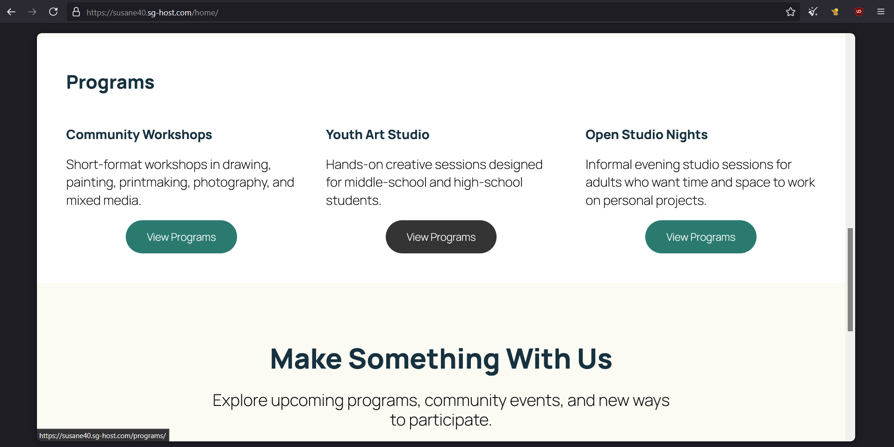
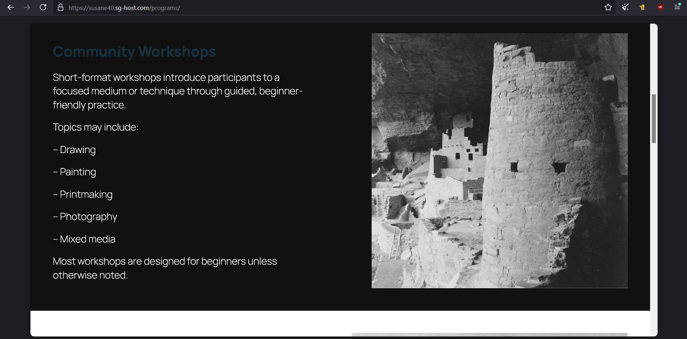
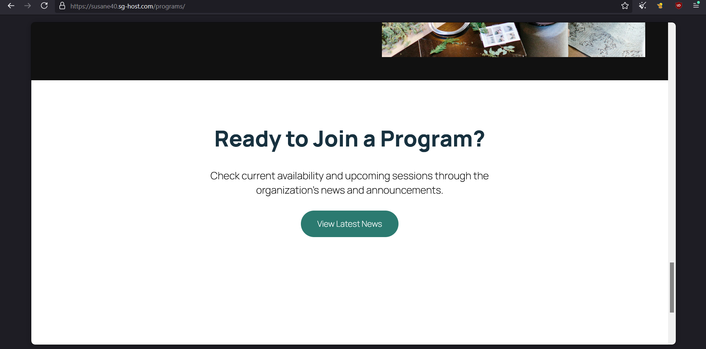
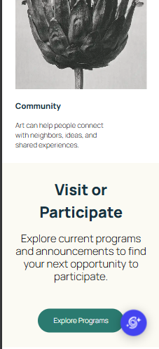
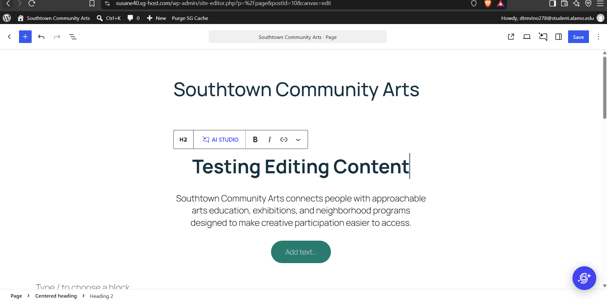

# Week 12: Customize the Experience — WordPress Development

**Client:** Southtown Community Arts  
**Role:** Junior WordPress Developer

## Project Overview

Briefly summarize how you customized the existing Week 11 CMS without making routine content harder for the client to maintain.

[My customizations included simple color and typography changes, as well as spacing changes. This way, the site looks more in line with branding, and does not heavily interfere with maintaining content.]

---

# Customization Decisions

Document the four required decisions below.

## 1. Global Design System

**Requirement:**  
[Color and typography.]

**Location:**  
[Global styles.]

**Change:**  
[Heading, button, link, typography and colors.]

**Why this level:**  
[A global solution was better since it maintains consistency across the site]

**QA:**  
[I tested if all headings, buttons, and links changed appropriately across the site.]

---

## 2. Branded Reusable Pattern

**Pattern:**  
[Southtown - Program Callout]

**Change:**  
[Visual changes to the heading and button elements.]

**Reuse:**  
[I verified the pattern in the Programs page.]

**Editor value:**  
[This helps a future editor update content by having a repeatable element that can easily be customizable and will change in all places it is implemented in if customizations are made.]

---

## 3. Site-Wide Structure Customization

**Shared area:**  
[Header area.]

**Change:**  
[Increased line height and font weight to bold.]

**Why this level:**  
[This change belonged in the shared site structure to maintain style consistency across the site.]

**QA:**  
[I checked the programs , home, and about pages to ensure style changes were implemented for all headers in the pages.]

---

## 4. Controlled Development-Level Modification

Complete **one** option.

**Option used:**  
[Targeted CSS.]

**Location:**  
[Custom Link.]

**Code / configuration snippet:**

```
&:hover {
  color: #c7855a;
}
```

**Reason:**  
[There is no hover state color change style option for the navigation links at the top of the page.]

**Documentation:**  
[https://wordpress.org/documentation/article/styles-overview/#site-wide-custom-css]

**QA:**  
[I verified my changes worked without causing problems by loading each page and testing the hover state for the navigation links.]

---

# Visitor + Editor QA

## Visitor Experience

- [ y ] I tested narrow and wide viewport behavior.
- [ y ] I checked visual consistency on more than one page.
- [ y ] I checked text/link/button contrast.
- [ y ] I verified visible keyboard focus.
- [ y ] I tested navigation and links.
- [ y ] I checked that the brand system is consistent rather than page-specific.

### Visitor QA Notes

[One important verification I made was making sure visibility and styling changes remained consistent and adapted well across different screen widths.]

## Editor Experience

- [ y ] Routine content is still editable through WordPress.
- [ y ] The branded pattern is understandable to reuse/edit.
- [ y ] My customization did not move ordinary client content into code.
- [ y ] I performed one temporary routine content edit, previewed it, and restored the original content.
- [ y ] The site remained visually coherent after the editor test.

### Editor QA Notes

[Updated header text in the Southtown Community Arts home page. Styling changes carry over and does not prevent changes to content.]

---

# Evidence

Use the exact filenames below.

## Customized Home



## Customized Programs



## Branded Reusable Pattern



## Responsive / Mobile View



## Editor Maintainability Test



---

# Maintainability Reflection

Write approximately **75–100 words** responding to:

> Give one example of a change you intentionally handled globally and one change you intentionally left as editable content. How does that separation help Southtown Community Arts maintain the site without losing design consistency?

[Write your response here.]

---

# Final Handoff Check

- [ ] I continued the Week 11 Southtown site rather than rebuilding it.
- [ ] I applied the approved palette and typography direction systematically.
- [ ] I used global controls for global decisions.
- [ ] I created or significantly customized one branded reusable pattern.
- [ ] I made one appropriate site-wide structure customization.
- [ ] I completed exactly one controlled development-level modification.
- [ ] I did not add PHP, plugins, custom blocks, or a child-theme build for this assignment.
- [ ] Visitor and editor QA are complete.
- [ ] All five evidence screenshots display in this README.
- [ ] I completed the maintainability reflection.
- [ ] I committed and pushed the Week 12 handoff folder.
